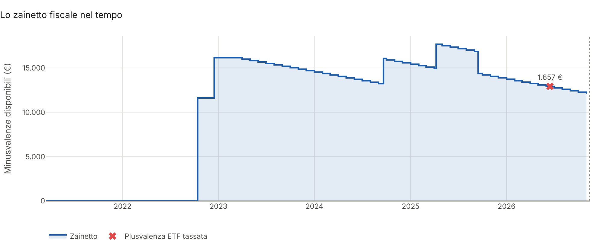
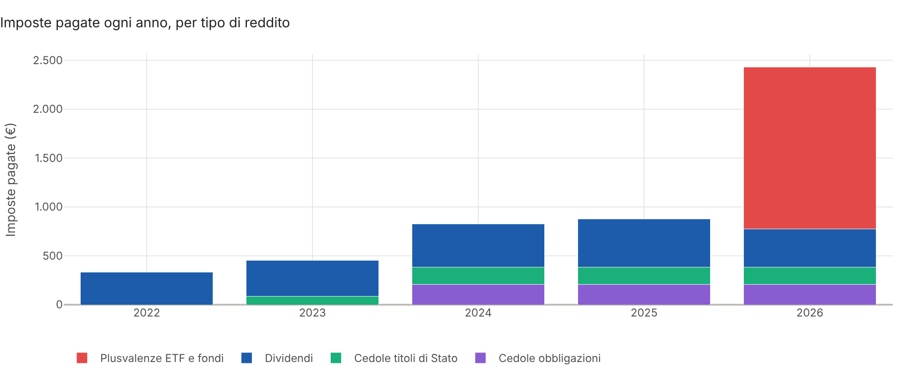
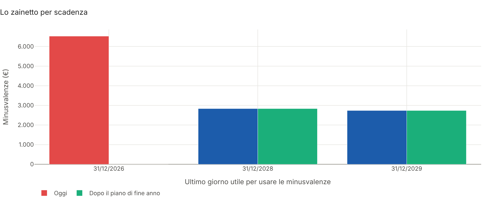
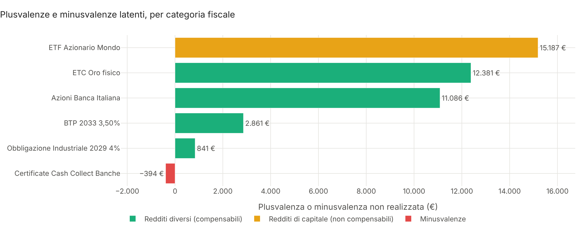
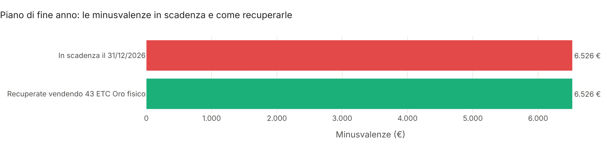
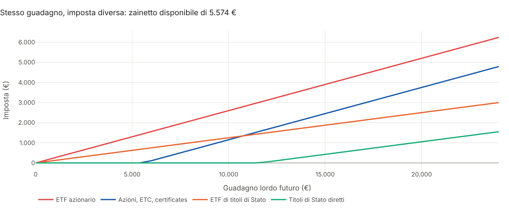
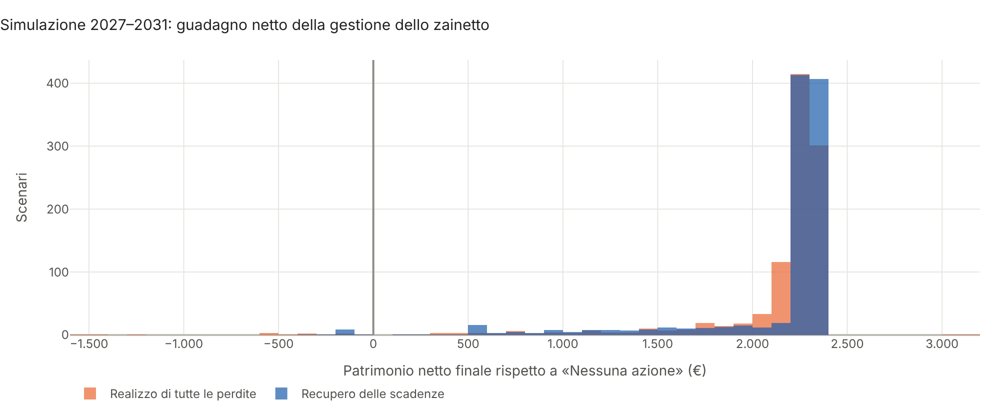
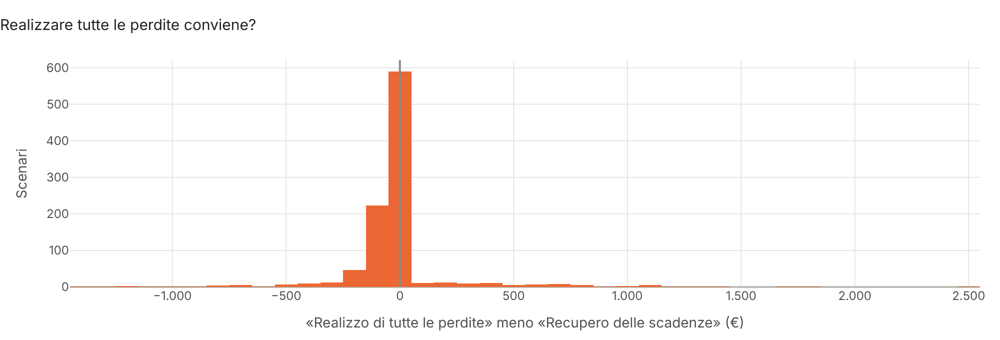

# Fiscale Investimenti IT

**La fiscalità degli investimenti in Italia, in Python: redditi di capitale e redditi diversi, aliquote del 26% e del
12,5%, zainetto fiscale con le scadenze, piano di fine anno per non perdere le minusvalenze e tax-loss harvesting
«all'italiana», con una simulazione Monte Carlo che misura quanto vale davvero.**

Il sistema italiano tassa i redditi finanziari con regole che sembrano semplici (26%, 12,5% sui titoli di Stato) ma
nascondono trappole costose. Le perdite di un ETF entrano nello zainetto fiscale, i suoi guadagni non lo possono usare.
Le minusvalenze scadono dopo quattro anni e la banca non avvisa. Una perdita compensa solo i guadagni realizzati
*dopo*. Le plusvalenze sui titoli di Stato consumano lo zainetto solo al 48,08%. Il progetto ricostruisce un dossier
titoli movimento per movimento **come fa la banca nel regime amministrato** e risponde alle domande che un consulente
si pone a novembre: **quanto ho nello zainetto e quando scade? Cosa vendo e riacquisto entro il 31 dicembre per non
perdere le minusvalenze? Conviene realizzare anche le perdite? E con quale strumento conviene investire, finché lo
zainetto è pieno?** Il risultato è un **report HTML interattivo** per il cliente.



## Cosa fa

| Area | Contenuto |
|---|---|
| **Regole** | Classificazione di azioni italiane ed estere, obbligazioni, titoli di Stato white list, ETF e fondi, ETC, certificates: categoria di guadagni, perdite e flussi periodici; aliquota del 12,5% come riduzione della base al **48,08%**, anche **pro quota** per gli ETF con titoli di Stato |
| **Regime amministrato** | Motore che applica le imposte movimento per movimento: **costo medio ponderato** con le commissioni, compensazione immediata dalle minusvalenze **più vecchie**, minusvalenze che compensano solo le plusvalenze **successive**, dividendi esteri tassati al netto della ritenuta estera, **scadenza** delle minusvalenze al quarto anno |
| **Zainetto** | Residui per anno di realizzo e per ultimo giorno utile, storia nel tempo, minusvalenze usate e scadute anno per anno, imposte pagate su redditi che lo zainetto non può compensare |
| **Latenti** | Plusvalenze e minusvalenze non realizzate con la loro categoria fiscale, base imponibile e imposta latente; capacità del portafoglio di assorbire minusvalenze |
| **Piano di fine anno** | Vendite e riacquisti che usano le minusvalenze in scadenza scegliendo prima gli strumenti con più plusvalenza per euro venduto; quantità calcolate con il 48,08% per i titoli di Stato; commissioni, spread e **Tobin tax** (nulla con il riacquisto nello stesso giorno); nuovo costo medio, imposta futura evitata e valore attuale |
| **Tax-loss harvesting** | Valore di una minusvalenza e convenienza di realizzare una perdita, con l'effetto sul costo fiscale e sull'imposta futura; importanza dell'ordine tra perdite e guadagni |
| **Veicolo** | Imposta su uno stesso guadagno con ETF, azioni/ETC/certificates, ETF di titoli di Stato e titoli di Stato diretti, dato lo zainetto disponibile |
| **Simulazione** | Monte Carlo su più anni con i prezzi correlati, flussi, rimborsi, bollo e costi: nessuna azione, recupero annuale delle scadenze e realizzo di tutte le perdite, confrontati sugli stessi scenari al netto di ogni imposta |
| **Report** | HTML in italiano con 9 grafici interattivi Plotly, registro fiscale completo, tabelle dello zainetto, del piano e della simulazione |

Tutto è scritto da zero su `numpy` e `pandas`, senza librerie fiscali «a scatola chiusa», così ogni passaggio è
verificabile. Grafici `plotly`, report `jinja2`.

## Avvio rapido

```bash
git clone https://github.com/Torraf-MI/fiscale-investimenti-it.git
cd fiscale-investimenti-it
pip install -e ".[png]"

# Report del caso dimostrativo (meno di un minuto con 1.000 scenari)
fiscale-investimenti --demo

# Senza la simulazione Monte Carlo (pochi secondi)
fiscale-investimenti --demo --veloce

# Un cliente descritto in un file JSON, con i grafici anche in PNG
fiscale-investimenti --config esempi/cliente.json --grafici output/img

# Report utilizzabile senza rete (plotly.js incluso nel file)
fiscale-investimenti --demo --offline
```

Il report viene salvato in `output/report.html`. Un esempio già generato:
[`docs/report_esempio.html`](docs/report_esempio.html).

I movimenti stanno in un CSV ([`data/movimenti_esempio.csv`](data/movimenti_esempio.csv)), lo stesso formato che si
ottiene in pochi minuti dall'estratto del dossier titoli:

```csv
data,operazione,strumento,quantita,prezzo,importo,commissioni
2022-10-14,vendita,ETF Obbligazionario Euro,1000,82.5,0,19.0
2023-04-01,premio,Certificate Cash Collect Banche,0,0,162.5,0
2023-09-01,cedola,BTP 2033 3,50%,0,0,700.0,0
```

Le operazioni sono `acquisto`, `vendita`, `rimborso`, `cedola`, `dividendo`, `premio` e `provento`. Il file JSON
([`esempi/cliente.json`](esempi/cliente.json)) descrive gli strumenti, i prezzi di oggi, eventuali minusvalenze
portate da un'altra banca e i parametri dei costi e della simulazione:

```json
"strumenti": [
  {"nome": "ETF Obbligazionario Euro", "tipo": "etf", "quota_stato": 0.65},
  {"nome": "Azioni Tecnologia USA", "tipo": "azione_estera", "ritenuta_estera": 0.15},
  {"nome": "BTP 2033 3,50%", "tipo": "titolo_stato", "cedola": 0.035, "scadenza": "2033-03-01"}
],
"prezzi": {"BTP 2033 3,50%": 99.2, "ETC Oro fisico": 345.0},
"zainetto_iniziale": {"2023": 1000}
```

## Uso come libreria

```python
from datetime import date
from fiscale_investimenti import Movimento, RegimeAmministrato, Strumento, Tipo, Zainetto, piano_recupero

strumenti = {s.nome: s for s in [Strumento("ETF Mondo", Tipo.ETF), Strumento("ETC Oro", Tipo.ETC)]}
motore = RegimeAmministrato(strumenti, Zainetto({2022: 4_000.0}))     # minus 2022: scadono il 31/12/2026
motore.processa([
    Movimento(date(2024, 1, 10), "acquisto", "ETF Mondo", 100, 80.0),
    Movimento(date(2024, 1, 10), "acquisto", "ETC Oro", 50, 190.0),
    Movimento(date(2026, 6, 15), "vendita", "ETF Mondo", 50, 115.0),   # reddito di capitale: 26% pieno
])
print(motore.registro)                                    # effetto fiscale di ogni movimento
print(motore.zainetto.per_scadenza(2026))                 # {2026: 4000.0}

piano = piano_recupero(motore.posizioni, {"ETF Mondo": 118.0, "ETC Oro": 345.0}, strumenti, motore.zainetto, 2026)
print(piano.tabella())                                    # vendere e riacquistare 26 ETC Oro
```

Esempio completo in [`examples/esempio.py`](examples/esempio.py). L'analisi completa è `analizza(configurazione)`, la
simulazione `Simulatore(strumenti).esegui(motore, prezzi, oggi)`.

## Risultati sull'esempio dimostrativo

Il caso è di fantasia ma costruito sulle situazioni tipiche. Una famiglia apre il dossier nel 2021. Nel 2022 vende in
perdita un ETF obbligazionario (65% titoli di Stato) e un'azione tecnologica americana: lo zainetto si riempie con
16.157 € di minusvalenze. Dal 2023 i premi mensili di un certificate cash collect e una vendita parziale di azioni
bancarie ne recuperano una parte. Nel 2024 e nel 2025 arrivano altre due piccole perdite. Nel giugno 2026 la famiglia
vende una parte di un ETF azionario in forte guadagno. Oggi, 12 novembre 2026, il portafoglio vale circa 185.000 €.

**L'asimmetria degli ETF.** La vendita dell'ETF azionario ha realizzato 6.375 € di guadagno e pagato **1.657 € di
imposte**, il 26% pieno, mentre lo zainetto conteneva 12.913 € di minusvalenze. Il guadagno di un ETF è un reddito di
capitale e non si compensa. In tutto, dal 2021, la famiglia ha pagato 4.916 € di imposte, tutte su redditi di capitale
(dividendi, cedole e quell'ETF); i 7.150 € di premi del certificate e la plusvalenza sulle azioni sono passati senza
imposte grazie allo zainetto.



**Lo zainetto oggi.** Restano 12.100 € di minusvalenze. Di queste, **6.526 € scadono il 31 dicembre 2026**: sono
il residuo del 2022, già ridotto al 66% per la quota di titoli di Stato dell'ETF obbligazionario. Le altre scadono a
fine 2028 e 2029.



**Le plusvalenze latenti.** Il portafoglio ha 25.683 € di base imponibile in plusvalenze compensabili (ETC sull'oro,
azioni bancarie, BTP, obbligazione societaria), più che sufficienti. La plusvalenza più grande, 15.187 € sull'ETF
azionario, non serve: è un reddito di capitale.



**Il piano di fine anno.** Basta vendere e riacquistare nello stesso giorno **43 quote dell'ETC sull'oro** (circa
14.800 €): la plusvalenza di 6.655 € assorbe tutte le minusvalenze in scadenza senza imposte e il costo medio fiscale
sale da 190 a 274 €. Costa 50 € tra commissioni e spread; alla vendita futura si pagheranno 1.697 € di imposte in
meno, che scontati su cinque anni valgono oggi 1.414 € netti. L'ETC viene prima delle azioni perché ha più plusvalenza
per euro venduto; il BTP verrebbe per ultimo, perché per assorbire 100 € di minusvalenze deve realizzarne 208 di
plusvalenza.



**Il veicolo conta.** Con lo zainetto che resterà dopo il piano (5.574 €), un guadagno futuro di 12.000 € costa
3.120 € di imposte con un ETF azionario e 1.671 € se ottenuto con azioni, ETC o certificates, che consumano lo
zainetto. Un ETF di titoli di Stato paga il 12,5% (1.500 €) ma non usa lo zainetto; i titoli di Stato diretti fanno
entrambe le cose e pagano 51 €.



**Quanto vale nel tempo.** La simulazione parte dal portafoglio di oggi e genera 1.000 scenari di mercato per il
2027–2031 (prezzi correlati, cedole, dividendi, premi, rimborsi, bollo dello 0,2%); alla fine vende tutto, così il
patrimonio è al netto di ogni imposta.

| Strategia | Patrimonio netto finale | Imposte | Minus scadute | Differenza media | 5° percentile | Scenari migliori |
|---|---|---|---|---|---|---|
| Nessuna azione | 218.138 € | 24.082 € | 9.082 € | – | – | – |
| **Recupero delle scadenze** | **220.266 €** | 21.866 € | 24 € | **+2.128 €** | +974 € | **99%** |
| Realizzo di tutte le perdite | 220.256 € | 21.808 € | 14 € | +2.118 € | +1.258 € | 99% |

Non fare nulla lascia scadere in media 9.082 € di minusvalenze. Recuperarle ogni dicembre vale **2.128 €** su un
portafoglio di 185.000 €, conviene nel 99% degli scenari e costa meno di 100 € di commissioni in cinque anni. Nell'1%
restante i mercati crollano, il portafoglio finisce in perdita e le minusvalenze non sarebbero servite comunque: si
perdono solo i costi.



**Realizzare tutte le perdite non serve.** Il tax-loss harvesting all'americana, vendere e riacquistare ogni dicembre
tutto ciò che è in perdita, rispetto al solo recupero delle scadenze rende in media 9 € in meno: fa meglio nel 10%
degli scenari e peggio nel 39%. In Italia una minusvalenza vale solo se c'è una plusvalenza compatibile entro quattro
anni, e abbassare il costo fiscale di un ETF aumenta un futuro reddito di capitale che lo zainetto non potrà
compensare. Il valore sta nel non perdere le minusvalenze, non nel crearne di nuove.



## Metodologia in breve

- **Categorie**: plusvalenze su azioni, obbligazioni, titoli di Stato, ETC e certificates, premi dei certificates e
  tutte le minusvalenze sono **redditi diversi** (art. 67 TUIR); cedole, dividendi, proventi e plusvalenze di ETF e
  fondi sono **redditi di capitale** (art. 44 TUIR).
- **Aliquote**: 26%; per titoli di Stato italiani, white list e sovranazionali la base è ridotta al 48,08% (12,5 / 26),
  sia per i redditi sia per le minusvalenze e la loro compensazione. Per ETF e fondi la riduzione vale per la quota di
  titoli di Stato del prospetto: base = reddito × (1 − q × 51,92%).
- **Costo fiscale**: costo medio ponderato con le commissioni di acquisto; le commissioni di vendita riducono il
  corrispettivo.
- **Compensazione**: nel regime amministrato ogni plusvalenza (reddito diverso) usa subito lo zainetto, dalle
  minusvalenze più vecchie; una minusvalenza compensa solo le plusvalenze successive; scadenza il 31 dicembre del
  quarto anno successivo a quello di realizzo (art. 68 TUIR, art. 6 D.Lgs. 461/1997).
- **Dividendi esteri**: 26% sull'importo netto della ritenuta alla fonte estera.
- **Piano di recupero**: candidati con plusvalenze latenti compensabili, ordinati per base imponibile per euro
  venduto; quantità = ⌈minusvalenze residue / (plusvalenza unitaria × quota imponibile)⌉; riacquisto nello stesso
  giorno. Valore = 26% × minusvalenze recuperate, scontato all'anno di vendita prevista, meno i costi.
- **Simulazione**: moto browniano geometrico per azioni, ETF e oro; ponte browniano verso il prezzo di rimborso per
  obbligazioni e certificates; tre fattori correlati (azioni, obbligazioni, oro); flussi annuali, bollo dello 0,2%,
  liquidità remunerata e tassata; stessi scenari per tutte le strategie; liquidazione completa alla fine.

## Struttura

```
src/fiscale_investimenti/
├── regole.py          # aliquote, 48,08%, categorie per tipo di strumento, scadenze, commissioni
├── strumenti.py       # strumento con classificazione fiscale e parametri di simulazione
├── zainetto.py        # minusvalenze per anno, compensazione dalla più vecchia, scadenze
├── motore.py          # regime amministrato: costo medio, imposte, registro fiscale, riepiloghi
├── pianificazione.py  # latenti, piano di fine anno, valore delle minusvalenze, confronto tra veicoli
├── simulazione.py     # Monte Carlo pluriennale delle strategie
├── dati.py            # caso dimostrativo
├── analisi.py         # analisi completa
├── configurazione.py  # caso dimostrativo e lettura da JSON + CSV
├── report.py          # grafici Plotly e report HTML
├── cli.py             # riga di comando
└── templates/         # modello del report
data/                  # movimenti dimostrativi (CSV)
esempi/                # configurazione di un cliente in JSON
examples/              # uso come libreria
tests/                 # 30 test (pytest), eseguiti a ogni push con GitHub Actions
```

## Test

```bash
pip install -e ".[dev]"
pytest
```

I test verificano le regole su casi calcolati a mano. Le aliquote effettive sono il 26%, il 12,5% e la media pesata per
un ETF misto. Lo zainetto usa prima le minusvalenze più vecchie e quelle scadute non compensano nulla. Il motore calcola
il costo medio ponderato con le commissioni, compensa una plusvalenza azionaria ma non quella di un ETF, porta nello
zainetto la perdita di un ETF di titoli di Stato ridotta al 48,08%, tassa la cedola di un BTP al 12,5% e un dividendo
americano al 26% del netto, fa pagare imposte se la plusvalenza precede la minusvalenza e nessuna nell'ordine inverso,
elimina le minusvalenze al cambio d'anno giusto. Nel caso dimostrativo ogni euro di minusvalenza risulta usato,
ancora nello zainetto o scaduto. Il piano sceglie lo strumento più efficiente, usa i titoli di Stato al 48,08%,
segnala le minusvalenze che non si possono recuperare ed eseguito nel motore non fa pagare imposte. La simulazione
porta le obbligazioni al rimborso, ha la media attesa per gli strumenti senza scadenza e non modifica il portafoglio
di partenza; JSON, CSV, report e riga di comando funzionano dall'inizio alla fine.

## Avvertenze

Le regole sono quelle in vigore nel 2026 per una persona fisica residente con un dossier in regime amministrato.
Non sono considerati lo scarto di emissione delle obbligazioni, le cripto-attività (dal 2026 al 33%), i redditi
d'impresa, il regime gestito e quello dichiarativo, il credito d'imposta per le ritenute estere, l'IVAFE e i casi
particolari (partecipazioni qualificate, OICR non armonizzati, polizze). In Italia non esiste una regola sulle «wash
sale»: vendere e riacquistare per realizzare plusvalenze o minusvalenze è prassi comune, ma va valutato caso per caso
alla luce del divieto di abuso del diritto (art. 10-bis dello Statuto del contribuente). Strumenti, prezzi e movimenti
dell'esempio sono di fantasia. Il progetto ha scopo dimostrativo e non costituisce consulenza fiscale né finanziaria.

## Licenza

MIT. Autore: Francesco Torraco.
